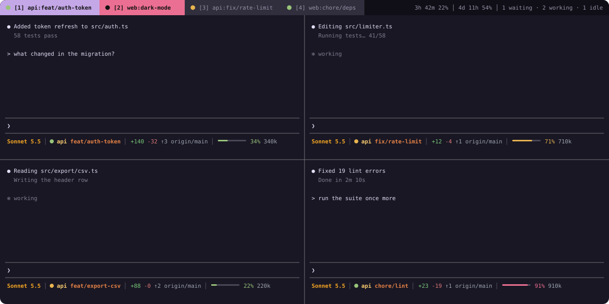
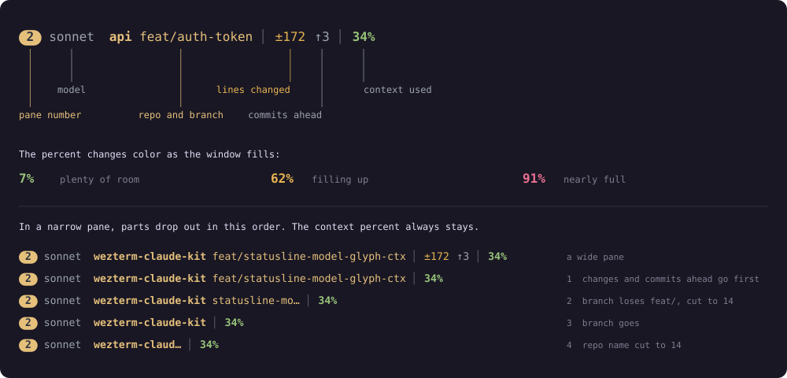
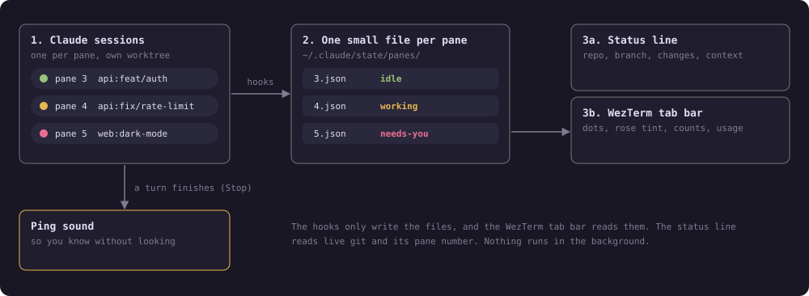

# wezterm-claude-kit

**Know which Claude session needs you, without opening every tab.**

If you run several Claude Code sessions at once, one per task or git worktree, it is easy to lose track of which one is working, which one finished, and which one is waiting for your answer. This kit puts that information where you already look: the WezTerm tab bar and each pane's status line. No background process, no extra window.



## What you get

**A tab bar that tells you what is going on.** Each tab shows `repo:branch` of the focused pane and a dot for the busiest state inside it. A tab with a session waiting for you turns rose, so you can spot it from across the room. On the right: how many sessions are waiting, working or idle, and your 5-hour and 7-day usage.

| Dot | Meaning |
| --- | --- |
| green | idle: the session finished its turn |
| yellow | working |
| rose tab | needs you: a permission prompt or a question |

**A status line that shows where each session stands.** The model's short name (`opus`, `sonnet`, `haiku`, `fable`) in dim gray, then repo and branch, how many lines you have changed (`±N`), how many commits you are ahead of the default branch (`↑N`), and the context percent, which turns amber, then rose, as the window fills. When a tab has several panes, each gets a rounded numbered badge before the model name, and its color also tints that pane's repo and branch so you can tell panes apart at a glance.

The line fits itself to the pane. In a narrow pane it drops the changes and commits first, then shortens the branch, then drops it, then shortens the repo name. The context percent always stays.



**A sound when a session finishes.** A soft "ping" so you can keep your eyes on something else.

## Quick start

You need macOS, [WezTerm](https://wezterm.org), [Claude Code](https://claude.com/claude-code), `jq` and `git`. It was built and tested on WezTerm `20240203`.

**1. Install the hooks and the status line.** This edits `~/.claude/settings.json` and saves a timestamped backup next to it first. Running it twice is safe.

```sh
git clone https://github.com/Khoa2001/wezterm-claude-kit.git
cd wezterm-claude-kit
bash install.sh
```

**2. Add the tab bar to `~/.wezterm.lua`.** Change the path to where you cloned the repo. If you already have a `format-tab-title` handler, merge the idea into it rather than adding a second one.

```lua
local wezterm = require("wezterm")
local config = wezterm.config_builder()
config.tab_max_width = 32 -- room for repo:branch

package.path = package.path .. ";/path/to/wezterm-claude-kit/wezterm/?.lua"
local tracker = require("tracker")

wezterm.on("format-tab-title", function(tab, _, _, _, _, max_width)
  local view = tracker.tab_view(tab)
  local needs_you = view.state == "needs-you"
  local bg, fg = "#312f3d", "#9492a5"
  if tab.is_active then bg, fg = "#c4a7e7", "#111111" end
  if needs_you then bg, fg = "#eb6f92", "#111111" end

  local title = view.title or tab.active_pane.title
  local label = string.format("[%d] %s", tab.tab_index + 1, title)
  local items = { { Background = { Color = bg } }, { Foreground = { Color = fg } }, { Text = " " } }
  for _, item in ipairs(tracker.dot(view.state, needs_you and fg or nil)) do
    table.insert(items, item)
  end
  table.insert(items, { Foreground = { Color = fg } })
  table.insert(items, { Text = wezterm.truncate_right(label, max_width - 4) .. " " })
  return items
end)

tracker.setup(config) -- counts and usage on the right, clean-up at startup

return config
```

**3. Restart your Claude sessions** so they load the hooks. WezTerm reloads its own config automatically.

To remove everything, run `bash uninstall.sh`. It backs up `settings.json` again and removes only this kit's entries. Delete the lines you added to `~/.wezterm.lua` by hand.

## Settings

All optional. Put them in the `env` block of `~/.claude/settings.json` or in your shell profile.

| Variable | What it does |
| --- | --- |
| `SESSION_TRACKER_SOUND` | Path to another sound file. Empty turns the sound off. Default: `/System/Library/Sounds/Ping.aiff`. |
| `SESSION_TRACKER_PLAYER` | Program that plays the sound. Default: `afplay`. |

## Good to know

- **"Needs you" means a permission prompt or a question.** A turn that ends with a plain question in text looks idle.
- **Pressing Esc mid-turn** can leave a pane yellow until its next event.
- **The sound plays every time a session finishes**, even for the pane you are looking at. A hook cannot tell which pane has focus.
- **The tab bar stays visible with a single tab**, because the counts and usage live there. `tracker.setup` turns off `hide_tab_bar_if_only_one_tab`.
- **The status line finds the pane width from the pane's terminal.** If it cannot, it shows everything and your terminal clips it.
- **Usage shows `n/a`** when the usage numbers are older than 15 minutes.

## How it works



Claude Code runs a small hook script on events such as a prompt, a tool call, a permission request and the end of a turn. The script writes one file per WezTerm pane, named after the pane's id. The WezTerm tab bar reads all of them. The status line shows live git and the context percent, and only needs its pane number from WezTerm. Nothing runs in the background, and every part is written to fail quietly: if anything goes wrong you see less, never a broken terminal.

<details>
<summary>Technical details</summary>

- **State file:** `~/.claude/state/panes/<WEZTERM_PANE>.json` with `{"state","repo","branch","cwd","session_id","ts"}`. States are `working`, `needs-you` and `idle`. Files are wiped when WezTerm starts, because pane ids restart.
- **Hook events:** `UserPromptSubmit`, `PreToolUse`, `PostToolUse`, `PostToolUseFailure`, `PermissionRequest`, `Notification`, `Stop`, `StopFailure`, `SessionStart`, `SessionEnd`. Subagent events are ignored except permission prompts and notifications.
- **Status line:** `statusline/statusline-command.sh`. Repo, branch, changed-line count and ahead count come from live git. The ahead count compares with `origin`'s default branch and never runs `git fetch`. It does not read the state files.
- **Pane numbers:** WezTerm writes `~/.claude/state/panes/<WEZTERM_PANE>.pos` with the pane's reading-order number, only while its tab has several panes. The status line turns it into the badge and its color.
- **Narrow panes:** Claude Code passes no width, so the script walks up its parent processes to the first one with a terminal and reads that terminal's width with `stty`.
- **Usage numbers:** read from `/tmp/.claude_usage_cache`, written by `~/.claude/fetch-usage.sh`, which is not part of this repo.
- **Tests:** `sh tests/run.sh` (needs `jq`, `git` and `luajit`).
- **Contributing:** see [`CLAUDE.md`](CLAUDE.md) for the architecture and the rules that are easy to break, and [`docs/`](docs/) for the original design and plan.

</details>
